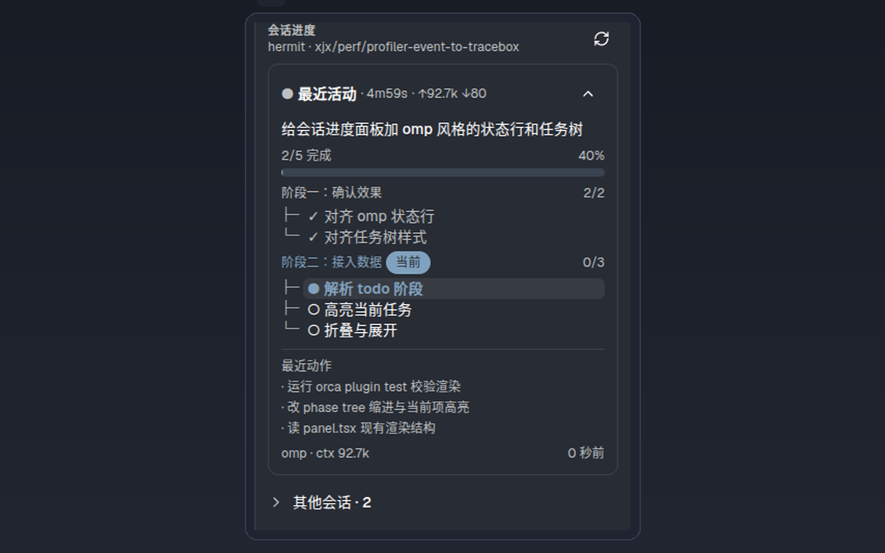

# Session Progress

An Orca sidebar panel that shows the focused workspace's agent session at a glance: a status line, and the agent's own todo plan as a task tree. No extra files, no cooperation from the agent — it reads the session records the agent already writes.



## What it shows

```
● 进行中 · 6m29s · ↑92.7k ↓80        ⌃
```

- **Status line**: the agent's state (working / needs you / waiting / done, or recent activity), how long the current turn has been running, the context size of the newest request (`↑`), and the output tokens generated since the newest user prompt (`↓`).
- **Task tree**: phases and tasks from the agent's plan. `✓` completed, `●` in progress, `○` pending, `⊘` dropped. The current task is highlighted and its phase is marked 当前. A progress bar shows done / total.
- **Fold**: the button in the status line collapses the tree to the current task only.
- **Recent actions**: the newest tool calls, shown as a fallback when the session has no todo plan.
- **Footer**: agent kind, context size, and last activity time.

The panel refreshes every 3 seconds.

## Data sources

| Agent | Session files | Plan |
|---|---|---|
| omp | `~/.omp/agent/sessions/<workspace>/` | `todo` tool result (`details.phases`) |
| pi | `~/.pi/agent/sessions/<workspace>/` | same session format as omp |
| Claude Code | `~/.claude/projects/<workspace>/*.jsonl` | `TodoWrite` tool calls; title from `ai-title` |
| Codex | `~/.codex/sessions/**/rollout-*.jsonl` | `update_plan` calls; `session_meta.cwd` selects the workspace |

The focused workspace is matched by name and branch through Orca's `workspace.readContext` and `workspace.list`. Only that workspace's sessions are read.

A session that has no todo plan yet shows its goal, recent actions and token counts, but no tree. In Claude Code, that means the session has not called `TodoWrite`; in Codex, no `update_plan`.

## Install

From the community catalog (after listing):

```
Settings → Plugins → Add marketplace → https://github.com/stablyai/orca-community-plugins.git
```

From source, as a development plugin:

```sh
orca plugin dev load . --json
orca plugin restart <plugin-key>
```

## Permissions

- `workspace:read`: the focused workspace's name, branch and terminals.
- `agent:read`: live agent state in that workspace.

The plugin runs as a trusted worker and reads the session files listed above. It writes nothing, contacts no agent, and makes no network requests.

## Development

```sh
orca plugin validate .
orca plugin check .        # renders the panel against mock scenarios
orca plugin test .         # panel and worker tests
```

Orca transpiles the TypeScript in `src/` directly; there is no build step. After edits, run `orca plugin dev load .` and restart the worker. If an open panel stays on its loading skeleton, switch to another panel and back to remount it.

## 中文说明

Orca 右侧栏的「会话进度」面板。顶部是状态行：`状态 · 本轮耗时 · ↑本轮上下文 ↓本轮输出`；下面按阶段列出 agent 自己的 todo 计划，`✓` 完成、`●` 进行中、`○` 待办、`⊘` 放弃，当前任务高亮，所在阶段标「当前」。右上角按钮可折叠任务列表。每 3 秒刷新，只读本地会话文件，不写文件、不联网。

| Agent | 会话位置 | 计划来源 |
|---|---|---|
| omp | `~/.omp/agent/sessions/<工作区>/` | `todo` 工具的 `details.phases` |
| pi | `~/.pi/agent/sessions/<工作区>/` | 与 omp 相同的格式 |
| Claude Code | `~/.claude/projects/<工作区>/*.jsonl` | `TodoWrite` |
| Codex | `~/.codex/sessions/**/rollout-*.jsonl` | `update_plan` |

没有 todo 计划的会话（例如没用 `TodoWrite` 的 Claude 会话）只显示标题、最近动作和 token，没有任务树。

## License

MIT